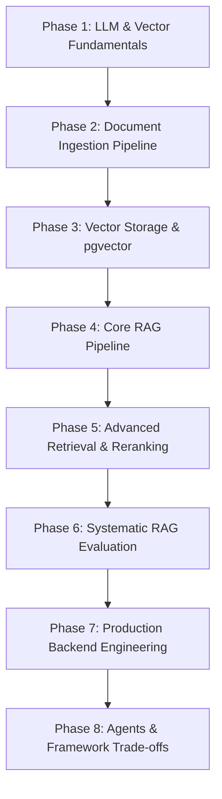

# Learning Roadmap: KnowledgeBase AI

This roadmap defines the path to mastering Retrieval-Augmented Generation (RAG) and production LLM application engineering from first principles.

---

## Roadmap Overview & Phases

---

### Phase 1: LLM & Vector Fundamentals (Current)
* **Goal**: Build an exact mental model of tokenization, vector embeddings, high-dimensional geometry, and similarity metrics.
* **Prerequisites**: Linear algebra basics (vectors, dot products, norms), TypeScript basics.
* **Concepts**:
  - Byte-Pair Encoding (BPE), token vocabularies, context windows
  - Dense embeddings vs. sparse representations
  - Vector space geometry: Euclidean distance, Dot Product, Cosine Similarity
  - Normalization ($L_2$ norm) and computational efficiency
  - Limitations of lexical search (keyword mismatch, polysemy, synonymy)
* **Milestone**:
  - [x] Understand vector math and cosine similarity
  - [x] Implement a standalone TypeScript similarity calculator and unit tests
  - [x] Connect to Gemini Embedding API (`gemini-embedding-001`) to generate real vectors
  - [x] Knowledge verification questions passed

---

### Phase 2: Document Ingestion Pipeline
* **Goal**: Transform unstructured documents (PDF, DOCX, Markdown, TXT) into semantically clean, retrievable chunks.
* **Prerequisites**: Phase 1 mastery, Node.js Streams/Buffers, regex, text normalization.
* **Concepts**:
  - Parsing nuances (tables, headers, footnotes, multi-column text)
  - Chunking strategies: Fixed-size with overlap, sentence/paragraph splitters, recursive character chunking, semantic/document-structure-aware chunking
  - Chunk size vs. chunk overlap trade-offs (context fragmentation vs. duplicate noise)
  - Metadata enrichment (source, page, timestamp, parent-child links)
  - Embedding generation with rate limiting and batching (Gemini Embedding API)
* **Milestone**:
  - [x] Build a modular recursive character chunker in TypeScript without external RAG frameworks
  - [x] Connect chunking pipeline to batch embedding generation and metadata enrichment
  - [x] Implement text sanitization and cleaning (control chars, null bytes, line wraps, whitespace)
  - [x] Implement file extraction (Markdown/Plaintext/PDF)
  - [x] Knowledge verification questions passed

---

### Phase 3: Vector Storage & Search with pgvector
* **Goal**: Store vectors efficiently in PostgreSQL and execute fast similarity queries at scale.
* **Prerequisites**: SQL fundamentals, relational schema design, Docker.
* **Concepts**:
  - PostgreSQL architecture with the `pgvector` extension
  - Vector data types: `vector(dim)`
  - Exact Nearest Neighbor (kNN) vs. Approximate Nearest Neighbor (ANN)
  - Indexing algorithms: IVFFlat (inverted file with flat quantization) vs. HNSW (Hierarchical Navigable Small World)
  - Index tuning parameters: `m`, `ef_construction`, `ef_search`, `lists`, `probes`
  - Combining relational filtering (WHERE clauses) with vector similarity (pre-filtering vs. post-filtering)
* **Milestone**:
  - [x] Spin up PostgreSQL with `pgvector` via Docker Compose
  - [x] Design and migrate database schema for documents, chunks, and embeddings
  - [x] Implement VectorRepository in TypeScript with similarity search and metadata filtering
  - [ ] Benchmark kNN (sequential scan) vs. HNSW index latency and recall
  - [ ] Knowledge verification questions passed

---

### Phase 4: Core RAG Pipeline (End-to-End)
* **Goal**: Connect retrieval with generation to create an accurate, grounded Q&A system.
* **Prerequisites**: Phase 2 and Phase 3 completed, prompt engineering principles.
* **Concepts**:
  - Query vectorization and Top-K retrieval
  - Context window assembly and token budgeting
  - Grounded prompt templates (system instructions, user constraints, context blocks)
  - Citation extraction: mapping generated assertions back to specific source chunk IDs
  - Dealing with "out of context" questions (graceful refusals vs. hallucinations)
* **Milestone**:
  - [ ] Implement complete end-to-end RAG query flow in TypeScript
  - [ ] Generate answers grounded exclusively in retrieved chunks
  - [ ] Return precise source citations (document title, page, chunk id)

---

### Phase 5: Advanced Retrieval & Reranking
* **Goal**: Overcome the core failure modes of naive vector search.
* **Prerequisites**: Phase 4 completed, probability and ranking metrics.
* **Concepts**:
  - Hybrid search: Combining BM25 / PostgreSQL full-text search (`tsvector`, `tsquery`) with dense vector search (Reciprocal Rank Fusion - RRF)
  - Cross-encoder reranking: Why bi-encoders are fast for retrieval but cross-encoders are superior for precision
  - Query reformulation: HyDE (Hypothetical Document Embeddings), query expansion, multi-query generation
  - Context compression and contextual chunk headers (Anthropic contextual retrieval pattern)
* **Milestone**:
  - [ ] Implement Reciprocal Rank Fusion (RRF) algorithm from scratch
  - [ ] Integrate a reranking step and measure retrieval quality improvements
  - [ ] Add query decomposition/expansion for complex queries

---

### Phase 6: Systematic RAG Evaluation
* **Goal**: Stop guessing whether retrieval is good; measure it objectively with quantitative metrics.
* **Prerequisites**: Phase 5 completed, information retrieval metrics.
* **Concepts**:
  - Retrieval metrics: Precision@K, Recall@K, Mean Reciprocal Rank (MRR), Normalized Discounted Cumulative Gain (nDCG)
  - Generation metrics: Faithfulness (hallucination detection), Answer Relevance, Context Precision
  - Building synthetic and ground-truth evaluation datasets (Golden Datasets)
  - Automated LLM-as-a-judge evaluation pipelines
* **Milestone**:
  - [ ] Curate an evaluation dataset of 20-30 diverse domain questions
  - [ ] Write an automated evaluation harness in TypeScript
  - [ ] Run A/B experiments: Naive RAG vs. Hybrid Search + Reranking

---

### Phase 7: Production AI Backend Engineering
* **Goal**: Turn the pipeline into a hardened, secure, low-latency API backend.
* **Prerequisites**: Express, async patterns, caching, security practices.
* **Concepts**:
  - Response streaming (Server-Sent Events / SSE)
  - Semantic caching (Redis) for vector queries
  - Rate limiting, token quotas, and concurrency controls
  - Security: Indirect prompt injection prevention, document-level authorization (multi-tenancy)
  - Observability: Tracing retrieval latency, embedding latency, generation latency, and token consumption
* **Milestone**:
  - [ ] Build clean REST / SSE endpoints in Express with strict input validation (Zod)
  - [ ] Implement multi-tenant data isolation at the database level
  - [ ] Add structured logging, OpenTelemetry-compatible tracing, and error fallbacks

---

### Phase 8: AI Frameworks & Agentic RAG
* **Goal**: Compare manual implementations against industry frameworks and build dynamic, multi-step retrieval agents.
* **Prerequisites**: Phases 1–7 fully mastered.
* **Concepts**:
  - LangChain and LlamaIndex under the hood: analyzing source code against our manual pipeline
  - Agentic RAG: Routing, tool calling, query self-correction, iterative multi-step research
  - LangGraph / stateful workflow orchestration
* **Milestone**:
  - [ ] Build an Agentic Retriever that decides whether to query docs, reformulate, or ask clarification
  - [ ] Write an in-depth architectural comparison: Custom TypeScript RAG vs. Framework Abstractions
