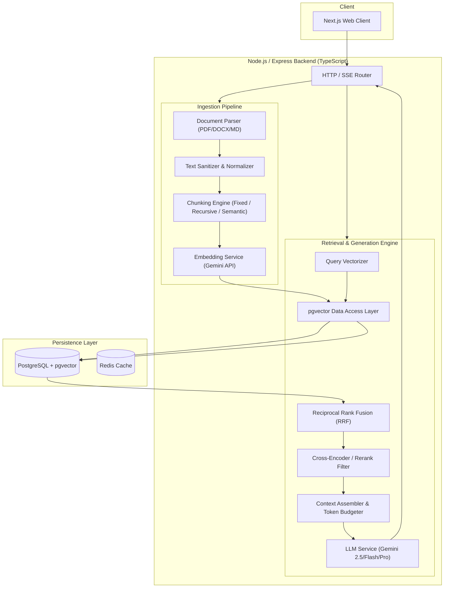

# KnowledgeBase AI: System Architecture

## 1. System Overview

KnowledgeBase AI is a production-grade Retrieval-Augmented Generation (RAG) platform built with TypeScript, Node.js, PostgreSQL (pgvector), and the Gemini API.

It implements a clean, decoupled architecture dividing ingestion, indexing, retrieval, and generation.

---

## 2. Component Architecture

---

## 3. Layer Responsibilities

1. **Ingestion Layer**:
   - Takes raw files (PDFs, Markdown, text).
   - Extracts plain text while preserving structure.
   - Splits content into semantic chunks with controlled token counts and overlap.
   - Computes dense vector embeddings via the Gemini Embedding model.
   - Persists chunks, vectors, and rich metadata to PostgreSQL.

2. **Storage Layer (PostgreSQL + pgvector)**:
   - Stores documents, document chunks, vector embeddings, and relations in an ACID-compliant database.
   - Uses HNSW (Hierarchical Navigable Small World) indexing for sub-millisecond approximate nearest neighbor (ANN) vector search.
   - Supports hybrid filtering (e.g., semantic similarity + user tenant ID + creation date).

3. **Retrieval Layer**:
   - Vectorizes incoming user queries.
   - Executes dense vector similarity search and sparse full-text search.
   - Combines and reranks candidate passages to produce the top-$K$ most relevant contexts.

4. **Generation Layer**:
   - Constructs grounded prompt instructions with strict anti-hallucination boundaries.
   - Injects top-$K$ retrieved chunks into the LLM context window.
   - Streams grounded answers with clear document/chunk citations back to the client.

---

## 4. Technology Selection Rationale

| Technology | Role | Why We Chose It | Alternatives & Trade-offs |
| :--- | :--- | :--- | :--- |
| **TypeScript / Node.js** | Core Backend & Business Logic | End-to-end type safety across database schemas, API contracts, and vector payloads. High I/O throughput for concurrent streaming and database requests. | Python is popular in AI experimentation, but TypeScript forces explicit architecture, clear interfaces, and mirrors production web application stacks. |
| **PostgreSQL + pgvector** | Vector & Relational Storage | Single unified database for relational entities (Users, Documents, Workspaces) and vectors. ACID transactions, mature tooling, rock-solid security, avoids data synchronization bugs across separate DBs. | Dedicated vector DBs (Pinecone, Qdrant, Milvus) specialize in billion-scale vectors, but add architectural overhead, extra network hops, and synchronization friction. |
| **Google Gemini API** | Embeddings & Generation | `text-embedding-004` (768 dimensions) offers state-of-the-art semantic quality, Matryoshka representation learning support, and high rate limits. Gemini models provide large context windows, fast streaming, and strong structured output capabilities. | OpenAI `text-embedding-3-small`, HuggingFace models. Gemini provides an accessible developer tier and excellent performance. |
| **Vitest** | Automated Testing | Fast TypeScript-native test runner. Essential for testing mathematical routines, token budgeting, chunking split logic, and retrieval ranking functions without external mocks. | Jest (slower, configuration-heavy with ESM and TypeScript). |
